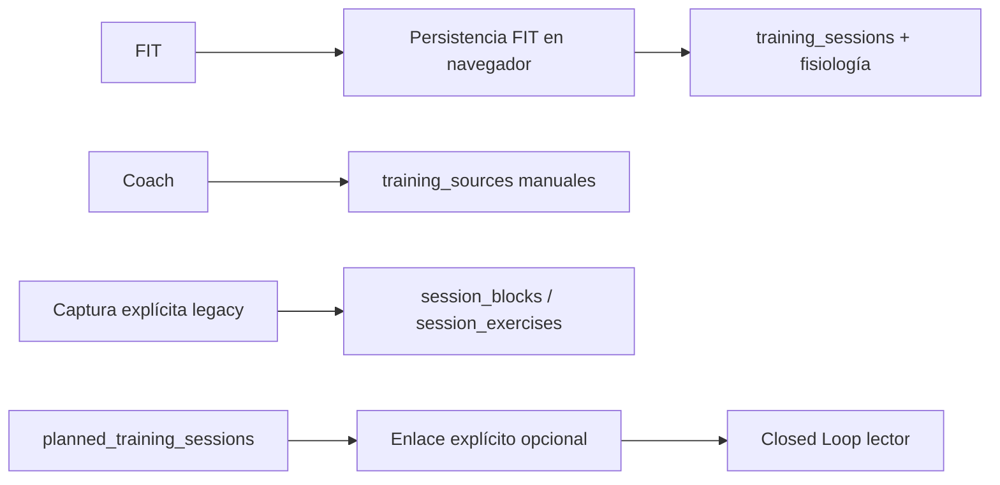
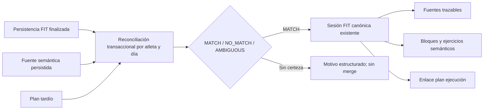

# Epic 100: auditoría previa a implementación — 2026-10-16

Base real: origin/main e380741bac50c2b396ff862acdde73b89312cf50. Producción rdduqsziboqxlgeqouxq consultada sólo mediante SELECT; ninguna migración, backfill ni despliegue aplicado.

## Diagnóstico confirmado

113 training_sessions (no 111), fechas 2026-05-12..2026-10-15. 241 bloques y 702 ejercicios, desde 25/05. 16 fixtures jotason del 20/04 al 13/05 con user_id NULL: no son historial del atleta. profiles.timezone = Europe/Madrid.

Actividades limita a 100 filas sin paginación. Consulta summary_metrics inexistente y reintenta con otra proyección. El detalle consulta enrichment_status inexistente; producción tiene status. El bloque de consulta defectuoso ya existe desde 4fdd3e6 (13/06), no es una regresión de Home #99.

persistParsedFitSession en src/main.jsx conserva identidad checksum/fingerprint, crea sesión, fuentes, muestras, métricas y series. reconcileSessionTemporalBlocks sólo reconcilia tiempos de bloques ya existentes: no consume training_sources manuales ni planes. loadClosedLoopAssessments consume linked_completed_session_id, no lo produce. No hay triggers de usuario en training_sessions, training_sources ni planned_training_sessions. No hay función común de reconciliación instalada.

Golden 21/07: 50bbee87-2713-4c5e-a4b6-96b5a5c8b920, 5 bloques, 21 ejercicios, FIT principal y manual_entry secundaria; bloques creados siete minutos después del FIT con prescription.source=chatgpt_manual_pilot. Golden 07/10: c1a1a6e5-a31c-4612-b20a-c70e4e1962fe, 6 bloques, 14 ejercicios; FIT 08/10 05:18:53 UTC, bloques 05:24:02 UTC; fuente Coach con provenance.fused_session_id y ID Garmin 24635520025. Es evidencia de enriquecimiento explícito posterior, no de reconciliación automática universal.

Los RPC legacy chatgpt_pilot_apply_capture y persist_conversation_enrichment materializan bloques con un target explícito, pero no resuelven la llegada de fuentes independientes. El primero puede crear sesiones manuales; el segundo reemplaza filas manuales. Ninguno implementa la política solicitada. No hay auditoría del autor SQL que permita afirmar qué llamada exacta produjo los golden; no atribuir esa operación a un commit sin evidencia.

Desde el 08/10 hay fuentes manual_pending_garmin_fit con actividad Garmin y timestamp explícitos, mientras los FIT correspondientes quedaron separados. El 14/10 tiene 0 bloques/0 ejercicios; fuente d4e9a378-4700-4593-b327-40ca92989bac contiene seis bloques y Garmin 24717314513, instante y duración coincidentes. El plan 14/10 está sin enlazar; el 15/10 YA está enlazado a Fuerza 12e50420-e31d-4e1b-b3ea-446c751be1d4. Pilates es otra ejecución. No se ha probado una eliminación reciente de lógica automática: se omitió el paso común entre persistencia de fuentes, semántica y enlace de planes. Los epics Health posteriores no solucionan ese hueco y no se modificarán.

## Flujo actual

## Flujo objetivo y decisiones

Una capa SQL cerrada decide y escribe; ningún nombre de tabla o SQL viene del modelo. No se crea una sesión por cada descripción: la fuente queda pendiente hasta que haya ejecución inequívoca. No se fusionan dos sesiones físicas existentes. Si una fuente ya está asociada a otra sesión, se requiere revisión.

Precedencia: enlace explícito existente (no alterar); referencias de actividad Garmin corroboradas por instante/tipo/duración; en ausencia de ID, instante observado + tipo + duración. Nunca título ni fuzzy. Aislamiento de usuario antes de comparación. Plan: fecha en timezone del perfil + modalidad estructurada + rango de duración + unicidad recíproca, además de planned_session_id explícito en una fuente físicamente corroborada o planned_time dentro de 15 minutos del instante observado. Sin ese anclaje no se enlaza. Dos candidatos implican AMBIGUOUS y cero enlace. FIT mantiene toda fisiología; descripción aporta exclusivamente semántica. Plan no escribe hechos ejecutados. Evidencia Trainer sólo añade fuente de soporte.

Punto de ejecución: RPC backend reutilizable, con adaptadores de evento mínimos. El importador FIT actual está en navegador, y el Coach externo puede escribir training_sources directamente: cambiar sólo una Edge Function dejaría entradas sin cubrir. Adaptadores SQL pequeños delegan a la misma función al finalizar wearable_activity_imports, persistir fuente semántica o persistir plan. No contienen matching ni un scheduler; no se añade infraestructura. Las fuentes anteriores al FIT no crean actividades ficticias. Fallos transaccionales no dejan semántica parcial.

## Superficie y fases

1. Este documento antes de código; snapshot local read-only para comparar golden y dry-run.
2. RPC, auditoría reversible, normalización acotada de bloques explícitos; tests de contratos reales y ambigüedad.
3. Histórico por periodos con paginación interna y orden total; status real; consultas relevantes sin campos inexistentes.
4. Pruebas unitarias, PostgreSQL transaccional, Coach evals, E2E, build, diff check. Un único PR; sin merge/deploy.

Tablas: training_sessions (sólo lectura desde reconciliador), training_sources (sólo lectura), session_source_links, session_blocks, session_exercises, planned_training_sessions (sólo enlace), profiles (timezone). Nueva auditoría de cambios; adaptadores en fuentes, planes y wearable_activity_imports. Frontend: carga por periodo y fallback conversacional. No modificar Garmin Health, scheduler, transport ni MCP writes.

## Backfill y rollback previstos

Primero ejecutar exactamente el evaluador sobre snapshot obtenido por SELECT de producción en base local; ningún DDL ni RPC nuevo en producción. Informe candidate/matched/ambiguous/skipped/already_reconciled con motivos, IDs y proyecciones. 21/07 y 07/10 deben quedar already_reconciled sin cambios. 14/10 se evalúa, no se fuerza. 15/10 conserva enlace existente.

Rollout futuro: migración revisada, comprobar permisos/RLS, habilitar entradas y observar; aplicar backfill acotado por usuario/día sólo tras revisión del dry-run. Cada operación registra IDs insertados y valores previos del enlace. Rollback compara estado actual contra after-image antes de retirar exclusivamente filas creadas por esa operación y restaurar el enlace; si hubo ediciones posteriores, abortar y revisar. Nunca borrar training_sources ni FIT. Deshabilitar adaptadores primero para impedir reejecución durante rollback. No ejecutar rollback ni backfill en este PR.

## Histórico pre-mayo separado

docs/coach-context/references/jotason contiene masters y sesiones, con inventario en source-json-inventory.md. Las tablas coach_session_fixtures y coach_session_blocks son fixtures diagnósticos. Una futura migración exige atribución explícita al atleta, inventario de IDs y fechas, deduplicación por evidencia, revisión de zonas horarias, conservación de originales y dry-run aprobado en otro rollout. No poblar user_id ni copiar filas ahora.

Coste incremental de diseño: 0,00 €. Sin API/LLM, servicios, planes, suscripciones ni infraestructura nueva.

## Incompatibilidades adicionales verificadas

- session_laps: producción tiene lap_order, started_at, elapsed_seconds, distance_m; no lap_index, source, start_elapsed_seconds, end_elapsed_seconds ni distance_meters. 29 filas actuales. La lectura y la inserción del frontend usaban columnas inexistentes; se añade un adaptador de DTO a ese contrato. Las filas históricas no se reescriben; los offsets futuros quedan en raw_payload junto al original preservado.
- training_sessions no tiene canonical_session, summary_metrics, completion_score ni universal_schema_version. session_blocks no tiene order_index, block_format, primary_measurement_type, rounds, time_cap_s ni summary_metrics. block_items, item_exercises, performed_sets y performed_metrics no existen en producción. Se retira esa ruta de lectura experimental fallida; el detalle sigue usando session_blocks/session_exercises, como los golden samples.
- La proyección de session_exercises omitía rounds_completed y tempo_or_pause, aunque existen; se incorporan a la lectura para conservar su visualización.
- El bootstrap E2E reproducía el campo falso enrichment_status. Se corrige a status para que los tests no oculten de nuevo el drift.

## Decisión conservadora final

El plan 14/10 tiene hora NULL y no consta planned_session_id en la fuente Coach. Aunque fecha/modalidad/duración coinciden, ese conjunto no distingue de forma suficiente una ejecución alternativa que llegue después. Resultado: fuente Coach/FIT MATCH; plan NO_MATCH con motivo no_execution_with_sufficient_plan_anchor. El 15/10 mantiene su enlace previo. La función no intenta completar todo el calendario a costa de enlaces inseguros.

La captura explícita del detalle usa capture_training_semantics_v1 bajo JWT/RLS, deriva su ámbito de auth.uid() y el target explícito, conserva el payload en training_sources y delega mediante el mismo evento. No crea training_sessions. Los RPC legacy de captura quedan retirados de los roles API mediante revocación de EXECUTE; se conservan sus definiciones para trazabilidad. Sus llamadores externos deben usar fuentes estructuradas o el nuevo contrato. No se promete normalización automática de cualquier JSON histórico ni texto libre: las fuentes sin blocks/sessions[0].blocks se reportan como unsupported_semantic_shape_preserved. Correcciones sobre semántica ya materializada requieren el flujo explícito de corrección existente, no reemplazo automático.

El histórico canónico no presenta local_date NULL ni discrepancias con started_at en Europe/Madrid en el snapshot auditado. Las páginas ordenan por local_date + UUID, con cursor estricto; los planes también paginan y la vista carga ambos por periodo.

Se retiran también las llamadas automáticas del navegador a reconcileSessionTemporalBlocks tras FIT/captura. Esa ruta hacía UPDATE de bloques desde frontend. El nuevo reconciliador no modifica tiempos/FC de bloques históricos ni inventa intervalos para semántica nueva; la fisiología y las series FIT conservan su detalle independiente. El servicio temporal legacy queda sin invocación automática desde la app.
